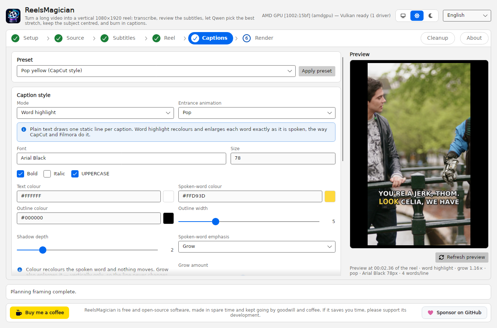
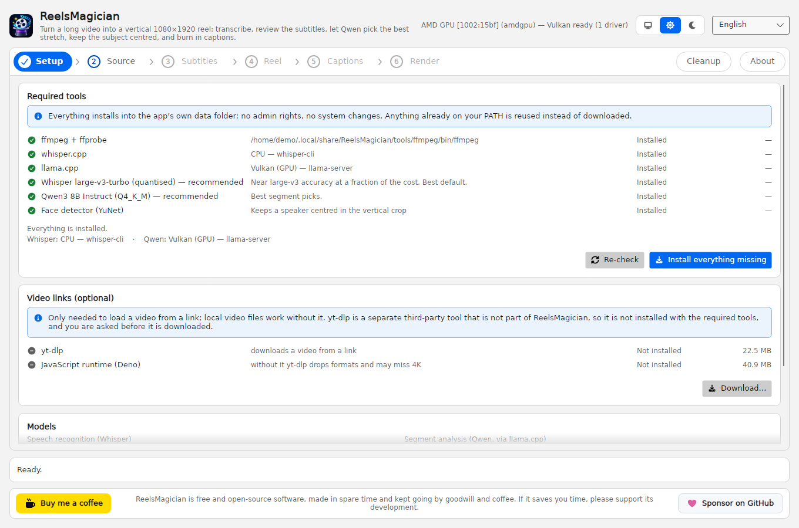
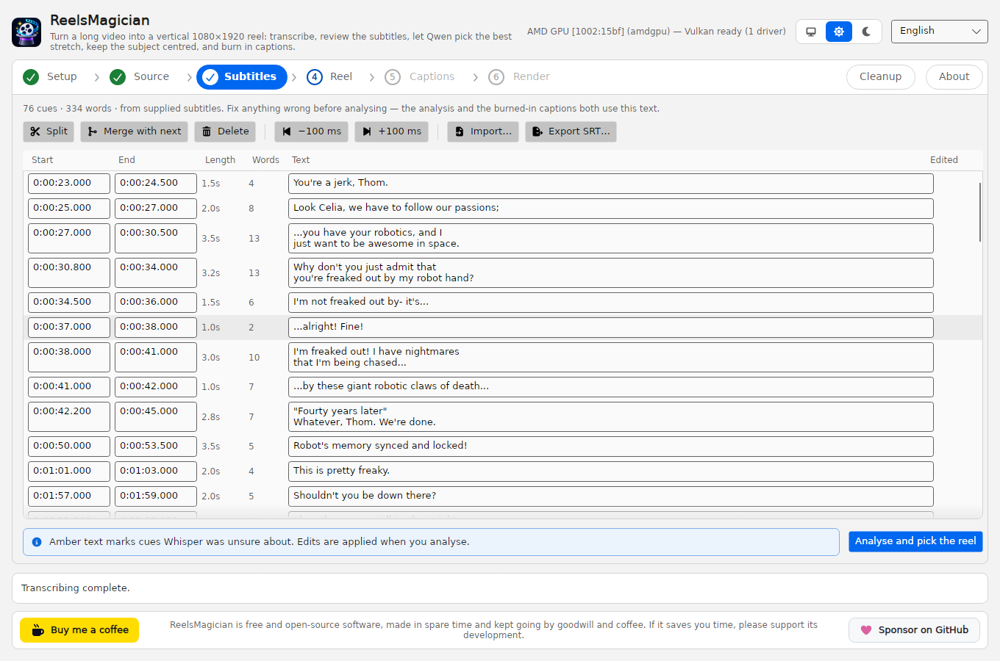
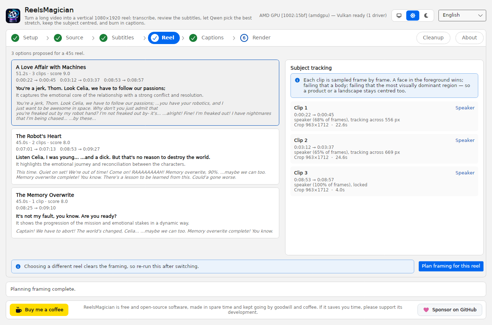
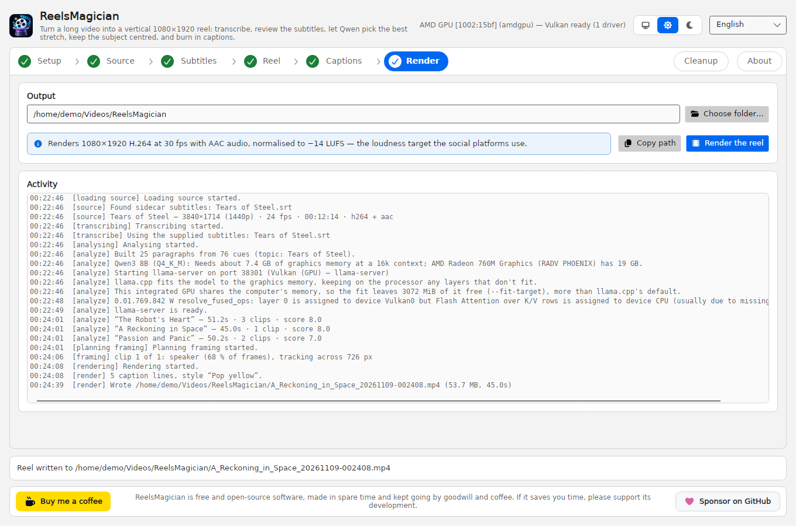
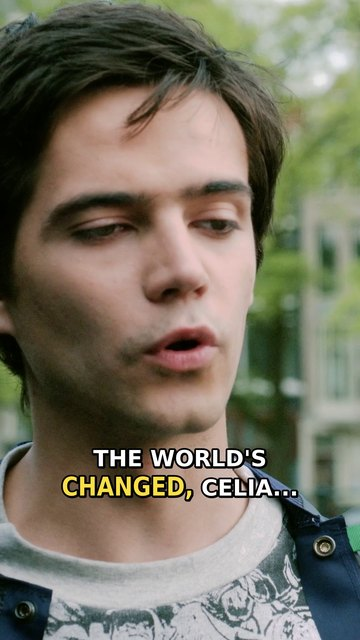
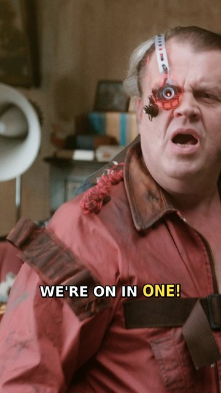
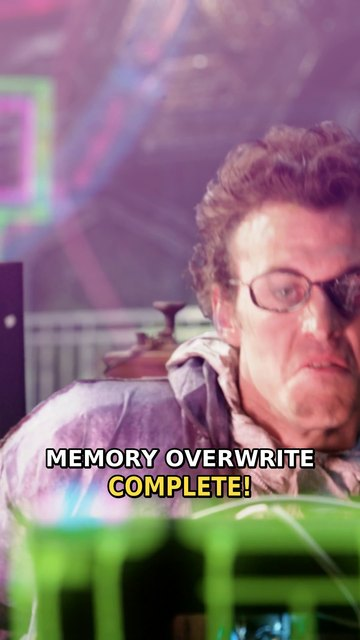

<p align="center"></p>

<h1 align="center">ReelsMagician</h1>

<p align="center"><b>Turn a long video into a vertical 1080×1920 reel, on your own computer.</b></p>

<p align="center">
  <picture>
    <source media="(prefers-color-scheme: dark)" srcset="docs/screenshots/captions-dark.png">
    
  </picture>
</p>

<table>
  <tr>
    <td width="50%" align="center">
      <picture>
        <source media="(prefers-color-scheme: dark)" srcset="docs/screenshots/setup-dark.png">
        
      </picture>
      <br><b>Setup</b>: the app installs its own tools and models.
    </td>
    <td width="50%" align="center">
      <picture>
        <source media="(prefers-color-scheme: dark)" srcset="docs/screenshots/subtitles-dark.png">
        
      </picture>
      <br><b>Subtitles</b>: check and correct every line before the analysis.
    </td>
  </tr>
  <tr>
    <td width="50%" align="center">
      <picture>
        <source media="(prefers-color-scheme: dark)" srcset="docs/screenshots/reel-dark.png">
        
      </picture>
      <br><b>Reel</b>: proposals with their hooks, and a crop that follows the speaker.
    </td>
    <td width="50%" align="center">
      <picture>
        <source media="(prefers-color-scheme: dark)" srcset="docs/screenshots/render-dark.png">
        
      </picture>
      <br><b>Render</b>: a 1080×1920 MP4, ready to upload.
    </td>
  </tr>
</table>

<p align="center">
  
  
  
  <br><sub>Three frames of the 51-second reel made in the screenshots above.</sub>
</p>

<p align="center"><sub>The screenshots show ReelsMagician on Linux, in the light and the dark theme (GitHub picks the one you use), working on
<a href="https://mango.blender.org/">Tears of Steel</a> with the film's own English subtitles.
Tears of Steel: (CC) Blender Foundation | mango.blender.org, licensed under
<a href="https://creativecommons.org/licenses/by/3.0/">CC BY 3.0</a>.</sub></p>

ReelsMagician is a desktop app for Windows and Linux. Point it at an MP4 or a compatible video link and it:

1. **transcribes the speech** with Whisper, or uses the subtitles that come with the video;
2. lets you **review and correct the subtitles**;
3. asks a local **Qwen** model to pick the most compelling stretch, and proposes several reels of the length you want;
4. **keeps the subject centred** in the vertical crop: a face, else a person, else whatever moves on screen;
5. joins the clips with a transition too short to smear the audio, and **burns in captions**: plain, or with each word highlighted as it is spoken, the way CapCut and Filmora do it.

Everything runs locally. Nothing is uploaded.

> **Status: an early and unstable preview.** It works end to end on the machines it has been
> tested on, Windows 11 and Ubuntu 26.10, but expect rough edges, and expect settings and on-disk
> formats to change between versions.

## Contents

- [Support ReelsMagician](#support-reelsmagician)
- [System requirements](#system-requirements)
- [Known limitations](#known-limitations)
- [How to use it](#how-to-use-it)
  - [Installing it](#installing-it)
  - [First start](#first-start)
  - [Making a reel](#making-a-reel)
  - [Cleanup and About](#cleanup-and-about)
  - [Light and dark](#light-and-dark)
  - [Language](#language)
  - [Caption presets](#caption-presets)
  - [Videos from a link](#videos-from-a-link)
  - [Updates](#updates)
  - [Where things live](#where-things-live)
  - [Freeing up space and uninstalling](#freeing-up-space-and-uninstalling)
- [Troubleshooting](#troubleshooting)
- [How it works](#how-it-works)
  - [The pipeline](#the-pipeline)
  - [The details that matter](#the-details-that-matter)
  - [Video links under the hood](#video-links-under-the-hood)
  - [CUDA and Vulkan](#cuda-and-vulkan)
  - [How updates are checked](#how-updates-are-checked)
- [Building it yourself](#building-it-yourself)
  - [Build and run](#build-and-run)
  - [Project layout](#project-layout)
  - [Tests](#tests)
- [Licence and third-party components](#licence-and-third-party-components)

## Support ReelsMagician

<table>
  <tr>
    <td align="center" width="200">
      <a href="https://buymeacoffee.com/idct"></a>
    </td>
    <td align="center">
      ReelsMagician is free and open-source software, made in spare time and kept going by goodwill
      and coffee. If it saves you time, please support its development.
    </td>
    <td align="center" width="200">
      <a href="https://github.com/sponsors/ideaconnect?frequency=one-time"><picture>
        <source media="(prefers-color-scheme: dark)" srcset="docs/screenshots/support-sponsor-dark.png">
        
      </picture></a>
    </td>
  </tr>
</table>

The same bar sits at the bottom of the app's window: **Buy me a coffee** leads to
[buymeacoffee.com/idct](https://buymeacoffee.com/idct), and **Sponsor on GitHub** to
[GitHub Sponsors](https://github.com/sponsors/ideaconnect?frequency=one-time).

## System requirements

| | Windows | Linux |
|---|---|---|
| **System** | Windows 11, x64. Windows 10 22H2 should work, but Microsoft and .NET no longer support it. | x64, in a **Wayland** session: Ubuntu 24.04 or newer, with GNOME, KDE Plasma, sway or another Wayland desktop. Other distributions with glibc 2.35 or newer and FUSE 3 should work too. |
| **Graphics card** | NVIDIA with a current driver (CUDA), or any card with a Vulkan driver (AMD, Intel) | Mesa's Vulkan driver (AMD, Intel) or the NVIDIA driver |
| **Graphics memory** | The default model, Qwen3 8B, needs about 9.7 GB; the lighter Qwen3 4B about 5.1 GB. Integrated graphics count the system memory they share. | the same |
| **Disk** | about 6 GB for the tools and default models, 0.5 GB more with an NVIDIA card; leave 10 GB free | about 6 GB; leave 10 GB free |
| **Internet** | on the first start, to download the tools and models; local videos then work offline | the same |
| **Installed with it** | nothing: the installer and the zip carry everything they need | nothing beyond FUSE 3 (`fuse3`), which Ubuntu installs by default |

A graphics card is strongly recommended for the analysis step. Without one, everything runs on the
processor, which works but is much slower. A model too big for the card runs with some of its
layers on the processor, which is slower too. The Setup tab says what the chosen model needs and
warns when this computer probably has too little.

[docs/system-requirements.md](docs/system-requirements.md) has the details for each system.

## Known limitations

- **An early preview.** Settings and on-disk formats can change between versions.
- **Windows and Linux on x64 only.** There is no macOS version, and ARM isn't supported.
- **Linux needs a Wayland session.** The app has no X11 mode.
- **Speech recognition on the processor** on Linux, and on Windows without an NVIDIA card:
  whisper.cpp publishes no Vulkan build for either. It still transcribes about 6× faster than real
  time on a modern processor. On Linux the analysis runs through Vulkan; there is no CUDA build.
- **Whisper can repeat one line through long stretches of music**, as on a film
  ([#75](https://github.com/ideaconnect/reels-magician/issues/75)). Check the Subtitles step, or
  put the video's own subtitles next to it (see [Making a reel](#making-a-reel)).
- **The builds aren't signed yet**, so Windows SmartScreen warns the first time.
- **Self-updating starts with the first release that has the Windows installer.** 0.1.0 and 0.2.0
  can't update themselves. The Windows zip, and an AppImage in a folder you can't write to, only
  link to the new release.
- **Release notes in the update box are plain text**: their Markdown is shown as written.
- **Linux: a generic icon in the dock** until the AppImage is integrated with the desktop (see
  [Troubleshooting](#troubleshooting)).
- **Linux: screen readers don't work yet.** The UI toolkit's Wayland support doesn't provide them
  so far.
- **Captions use the fonts installed on this computer.** A preset whose font is missing falls back
  to a similar one, so captions can look slightly different from one computer to another.
- **The interface speaks English and Polish** only.
- **Footage with no clear subject**: the crop follows the visual energy, and can wander.
- **Video links rely on yt-dlp and Deno**, third-party tools that follow the sites' changes. You are
  responsible for having the right to download each video you load from a link.

## How to use it

### Installing it

Releases come as an installer and a zip for Windows, and an AppImage for Linux, on the
[releases page](https://github.com/ideaconnect/reels-magician/releases).

- **Windows, with the installer (recommended):** run `ReelsMagician-win-x64-Setup.exe`. It installs
  the app for your account only, with no admin rights, into `%LOCALAPPDATA%\IDCT.ReelsMagician`
  (about 340 MB), with shortcuts in the Start menu and on the desktop, and lists it under
  **Installed apps** in Settings, where you uninstall it. Neither the installer nor the app is
  signed yet, so SmartScreen asks once: choose **More info**, then **Run anyway**.
- **Windows, from the zip:** unzip `ReelsMagician-win-x64.zip` anywhere and run `ReelsMagician.exe`.
  Nothing is installed, and SmartScreen asks the same way. The zip and the installer use the same
  data folder, so moving from one to the other downloads nothing again.
- **Linux:** `chmod +x ReelsMagician-x86_64.AppImage`, then run it from a Wayland session. GNOME
  and KDE show its icon in the dock once the AppImage is integrated with the desktop, which
  [Gear Lever](https://github.com/mijorus/gearlever) or
  [AppImageLauncher](https://github.com/TheAssassin/AppImageLauncher) does for you. Until then the
  dock shows a generic icon (see [Troubleshooting](#troubleshooting)).

### First start

Open **1 · Setup** and press **Install everything missing**. The app downloads ffmpeg, whisper.cpp,
llama.cpp and the default models, about 6 GB, into its own data folder: no admin rights, no system
changes, nothing added to your PATH. It resumes if interrupted, so a dropped connection is not a
restart. Tools already on your PATH, most likely ffmpeg, are reused rather than downloaded again.

The **Models** card picks smaller Whisper and Qwen models if you are short on disk or graphics
memory. It says what the chosen model needs, and marks a model that probably won't fit this
computer with an amber sign. You can still run it.

### Making a reel

The strip at the top of the window is the app's menu, one chip per step. It also shows how far
you have got: a step's number turns into a check once its output exists, the step to do next has
its number ringed, and the steps after it are dimmed. Every step stays open to you, and says what
it needs.

**2 · Source** — paste a link or browse to a file, set the reel length, press **Load source**.
The first time you load a link, the app asks before downloading yt-dlp. Subtitles that come with
the video are used instead of Whisper while **Use subtitles that come with the video when available** is ticked:
a link's own subtitles, or for a local file, a subtitle file with the same name next to it
(`My talk.srt` beside `My talk.mp4`; `.vtt` and `.ass` work too). The topic box is prefilled from
the title or filename; correct it if it is wrong, because the analysis is anchored to it. Then
**Transcribe**.

**3 · Subtitles** — the review step. Every cue with its times, editable in place. Amber text marks
cues Whisper was unsure about, so you can aim your attention; subtitles that came with the video
are never amber. Split, merge, nudge by 100 ms, delete, or import and export SRT.

Edits are safe: when you change a line, word timings are re-derived so that words which survived
the edit keep their original timing and only new ones are re-spread. A typo fix never
desynchronises the rest of the line — which matters, because these timings drive the karaoke
highlight. An edit doesn't change the line's colour either: a line stays amber, or not, by what
Whisper made of that part of it, and the **Edited** column shows the lines you have changed.

Press **Analyse and pick the reel** when you are happy.

**4 · Reel** — the proposals, each with its hook, its reasoning and its clip ranges. Pick one and
press **Plan framing for this reel**; the panel on the right then reports what it locked onto for
each clip ("speaker, 68% of frames", "main visual subject, tracking across 685 px").

**5 · Captions** — the caption table. Start from a preset, then adjust anything: mode, entrance
animation, font, size, colours, outline, shadow, background box, position, words per line, the
shortest time a line may stay up, the fastest reading rate, and how the spoken word is
emphasised — **Colour** recolours it and nothing moves at all, **Grow** also enlarges it
vertically, which still leaves the line's width, and so its position, untouched. **Refresh
preview** renders a real frame of your reel with the captions burned in. Transition length lives
here too.

**6 · Render** — choose an output folder and go. **Copy path** copies the reel's full path, ready to
paste into an upload page's file dialog, a file manager or a terminal. The activity log shows every
step.

File pickers and confirmations are drawn by the app itself, the same on both systems. A question
always defaults to the answer that changes nothing.

### Cleanup and About

**Cleanup** — on the right of the strip, apart from the steps and without a number: frees up space
in the app's data folder (see [Freeing up space and uninstalling](#freeing-up-space-and-uninstalling)).

**About** — beside Cleanup: the app's version (or "development build" for a build not made from a
release), the system it runs on and the data folder, with **Copy path**; who makes it, with a link
to [idct.tech](https://idct.tech/); links to the repository, its issues (**Report a problem**) and
its releases; the update settings; and every licence involved. Each component of the app and its
package has a **View licence** button, which shows the text the build carries in the app itself,
including inside the AppImage. The downloaded tools and models are marked installed or not, so you
can see which terms apply on your machine: GPL-3.0 for the app's ffmpeg, NVIDIA's CUDA EULA where a
CUDA build was installed, GPLv3+ for yt-dlp.

### Light and dark

The switch at the top right picks the theme: **follow the system** (the desktop icon, the default),
**light** (the sun) or **dark** (the moon). It applies at once and is remembered. The dark theme is
true black, for OLED screens; the light one is off-white, so a bright IPS panel doesn't glare. The
accent colour of the buttons and the selected step is your system's, where it has one.

- **Windows:** follows the Windows light or dark mode and accent colour, as they change.
- **Linux:** follows the desktop's light or dark style through `xdg-desktop-portal`, as GNOME and
  KDE Plasma provide it. Where the portal doesn't say dark, or there is no portal (sway and other
  wlroots desktops often have none), the app reads GTK's own setting instead: `GTK_THEME`, then
  `gtk-application-prefer-dark-theme` or a `gtk-theme-name` ending in `-dark` in
  `~/.config/gtk-4.0/settings.ini` and then `gtk-3.0/settings.ini`. With no answer from either, it
  is light. GTK's files are read at start and whenever you pick **follow the system** again.

### Language

The interface speaks English and Polish. The list beside the theme switch picks **System
language** (the default: Polish when the system's interface is Polish, English otherwise),
**English** or **Polski**. It applies at once, without a restart, and is remembered as `language`
in settings.json (`system`, `en` or `pl`). Sizes, times and numbers on screen follow the language
too, "22,5 MB" in Polish, and keep your system's regional settings when they are for the same
language. The log, settings.json and every file the app writes for ffmpeg stay the same in either
language, so a bug report reads the same whoever sends it.

### Caption presets

| Preset | Look |
|---|---|
| Plain white | Static lower-third lines, no highlighting |
| Pop yellow | White text, spoken word in yellow and scaled up, pop entrance |
| Green karaoke | Tighter three-word lines, green highlight, slide-up entrance |
| Boxed caption | Filled background box instead of an outline; colour-only highlight |
| Big bounce | Large Impact-style text with an overshooting bounce |

### Videos from a link

Loading a video from a link is optional. It needs two components that are not part of
ReelsMagician and are not installed with the tools above:

| Component | Source | Size |
|---|---|---|
| yt-dlp | yt-dlp releases | ~23 MB |
| Deno (JS runtime for yt-dlp) | deno releases | ~41 MB |

The first time you load a link, the app asks before downloading them; you can also start the
download from **Video links** on the Setup tab. If you decline, local video files keep working as
normal. A yt-dlp already on your PATH is used without asking. You are responsible for having the
right to download each video you load from a link, and for following the terms of the site it comes
from.

### Updates

Once the window is up, at most once a day, ReelsMagician asks GitHub whether there is a newer
version. A development build never checks. A newer version shows in the status area and on the
**About** tab, with its release notes, **Update now**, **Later** and **Skip this version**; nothing
is installed until you choose **Update now**, and never while a step is running.

- **Windows, installed:** the app downloads the new version and restarts into it. 0.1.0 and 0.2.0
  can't update this way: install the first release with an installer by hand.
- **Linux AppImage:** the new AppImage replaces the one you run; **Restart now** starts it. In a
  folder you can't write to, such as `/opt`, you get a link to the release page instead, as you do
  with the Windows zip, whose files are yours to manage.

To turn it off, clear **Check for updates** on the **About** tab; **Check now** still asks once.
**Include pre-releases** is on by default, because every release so far is a pre-release. What is
sent and how downloads are checked: [How updates are checked](#how-updates-are-checked).

### Where things live

```
%LOCALAPPDATA%\ReelsMagician\        on Windows
~/.local/share/ReelsMagician/        on Linux
  tools\      ffmpeg, whisper.cpp, llama.cpp; yt-dlp and the JS runtime if you downloaded them
  models\     Whisper, Qwen and face detector weights
  cache\      per-project working files (audio, clips, subtitles)
  downloads\  partially fetched archives
  logs\       error logs
  settings.json
```

Reels are written to `Videos/ReelsMagician` in your home folder unless you choose otherwise.

On Windows the installer puts the app itself in `%LOCALAPPDATA%\IDCT.ReelsMagician`, beside the
data folder rather than in it.

The app used to be called Selfroller. On first run it moves an existing `%LOCALAPPDATA%\Selfroller`
folder to the new name, so nothing has to be downloaded again. An output folder you already chose
is kept as it is.

### Freeing up space and uninstalling

**Free up space** on the **Cleanup** tab measures what each part of the data folder costs on disk,
afresh each time the tab opens, and removes the parts you tick:

| | ticked by default | why |
|---|---|---|
| Working files | yes | Safe to clear whenever — the app recreates them |
| Logs | no | Tiny, and useful when something has gone wrong |
| Downloaded tools | no | ~280 MB to fetch again |
| Downloaded models | no | Several gigabytes to fetch again |
| Settings | no | Resets your model choices and output folder |

The button names the amount it is about to delete, and confirms with the exact list before doing
anything. It only ever touches paths inside the data folder — a path outside it, the folder root
itself, or a `..` traversal is refused rather than followed.

**Uninstalling keeps your tools, models and settings.** On Windows, uninstall from **Installed
apps**; that deletes the app and its shortcuts and leaves the data folder,
`%LOCALAPPDATA%\ReelsMagician`, about 6 GB. To free that space, use **Free up space** before you
uninstall, or delete the folder afterwards. On Linux, delete the AppImage and
`~/.local/share/ReelsMagician`.

## Troubleshooting

**Linux: "ReelsMagician needs a Wayland session"** — log in to a Wayland desktop. On Ubuntu 24.04,
choose **Ubuntu** rather than **Ubuntu on Xorg** on the login screen. The app has no X11 mode.

**Linux: the AppImage does not start** — it needs FUSE 3 (`fusermount3`, in the `fuse3` package),
which Ubuntu installs by default. Without it, run it as
`./ReelsMagician-x86_64.AppImage --appimage-extract-and-run`.

**Linux: a generic icon in the dock** — on Wayland an app can't give its window an icon. The
desktop finds it through the window's app id, `ReelsMagician`, in an installed
`ReelsMagician.desktop` file, and an AppImage installs none by itself. Integrate the AppImage with
Gear Lever or AppImageLauncher, and the dock, the app list and the window switcher show the icon.
Once Avalonia supports the protocol that lets a window send its icon
([AvaloniaUI/Avalonia#21910](https://github.com/AvaloniaUI/Avalonia/issues/21910)), desktops that
implement it, such as KWin 6.7 and labwc, will show it without integration.

**Linux: "no driver for this GPU"** — install Mesa's Vulkan drivers (`mesa-vulkan-drivers`), or
the NVIDIA driver on an NVIDIA card. Without one, Qwen runs on the CPU, which works but is much
slower.

**"Vulkan loader present but no driver found"** — update your graphics driver. Without Vulkan (or,
on an NVIDIA card, CUDA) the app falls back to the CPU llama.cpp build, which works but is much
slower.

**llama.cpp shows Vulkan on an NVIDIA card** — either the driver is too old for the CUDA builds,
or llama.cpp was installed before the app picked CUDA. Update the driver, delete
`%LOCALAPPDATA%\ReelsMagician\tools\llama`, and press **Install everything missing**.

**Analysis is slow or runs out of memory** — pick Qwen3 4B on the Setup tab, or lower the context
size, `llamaContextSize` in `settings.json`: the default Qwen3 8B needs about 9.7 GB at its 32768
and 7.4 GB at 16384. Choosing a model on the Setup tab sets its own context again. A model too big
for the graphics card runs with some of its layers on the processor, which is slower; the Setup tab
warns about it beforehand.

**The subtitles repeat one line over and over** — Whisper got stuck over a stretch of music
([#75](https://github.com/ideaconnect/reels-magician/issues/75)). Use the video's own subtitles if
it has any (a `.srt` with the same name next to a local file), or delete the repeated lines on the
Subtitles step before analysing.

**The reel picked a dull stretch** — check the topic on the Source tab first; a wrong topic
misdirects the scoring. Otherwise choose a different proposal on the Reel tab, or re-analyse.

**The crop wanders** — expected on footage with no clear subject, where it follows visual energy.
Raise `deadzoneFraction` or `smoothingSeconds` in the framing options to calm it down.

**Captions are in the wrong font** — the font must be installed on this machine; libass falls back
silently otherwise. The dropdown lists only installed fonts.

## How it works

### The pipeline

| Stage | What happens |
|---|---|
| **Source** | Opens a local file, or downloads a link with yt-dlp, an optional third-party tool you are asked about the first time you load a link. Downloads prefer 4K and refuse to settle below 1080p while a better format exists. Progress is reported throughout — a 4K master is often over a gigabyte. |
| **Transcribe** | Uses the subtitles that came with the video if there are any, otherwise runs Whisper with word-level timings. |
| **Review** | Shows every cue with its in and out times in an editable table. Fix the text, split, merge, retime, delete. |
| **Analyse** | Groups cues into paragraphs, scores each paragraph against the video's topic with Qwen, then assembles several complete reels of the length you asked for. |
| **Framing** | Samples frames of the chosen clips and tracks the subject, so the vertical crop follows it instead of taking a fixed centre slice. |
| **Captions** | A style table drives the burned-in captions: plain text, or per-word highlighting with a colour and a pop. Preview against a real frame. |
| **Render** | Encodes 1080×1920 H.264 + AAC, loudness-normalised to −14 LUFS. |

Everything the app runs, it installs itself, into its own data folder:

| Component | Source | Size |
|---|---|---|
| ffmpeg + ffprobe | BtbN FFmpeg-Builds | ~95 MB |
| whisper.cpp | ggml-org/whisper.cpp | ~29 MB |
| llama.cpp | ggml-org/llama.cpp | ~124 MB, ~600 MB as the CUDA build |
| Whisper large-v3-turbo (q5) | ggerganov/whisper.cpp | ~547 MB |
| Qwen3 8B Instruct (Q4_K_M) | Qwen/Qwen3-8B-GGUF | ~4.7 GB |
| Face detector (YuNet) | opencv / opencv_zoo | ~0.2 MB |

### The details that matter

**Whole paragraphs, not words.** The analyser never sees isolated words. Cues are grouped into
paragraphs on sentence endings and speech pauses, capped so no block is too long to reason about
or too short to stand alone. Every paragraph is scored on whether it would hold a scrolling
viewer, and the assembly pass builds runs that open on a hook and end on a complete thought.

**The topic is an input.** For a link, the video title; for a file, the filename with release-tag
noise stripped out. Both scoring passes are anchored to it, and you can correct it before
analysing if it is misleading.

**Long videos still work.** Scoring runs over overlapping windows of paragraphs, so an
hour-long transcript never has to fit in one context window.

**Captions match the language actually spoken.** A compatible video link can offer machine-translated
caption tracks next to the real ones — a Polish video offers `en-pl`, "English from Polish". ReelsMagician reads the
video's own language and takes the original track (`pl-orig`, then `pl`), never a translation.
Burning translated captions over the original speech, timed to the translation, would be worse
than having no subtitles at all. Subtitles are also fetched in a separate pass, so a hiccup on one
caption track cannot throw away a gigabyte-scale download that succeeded.

**Subject tracking, in three tiers.** A face in the foreground wins, chosen by apparent size with
hysteresis so the crop does not flip between two people on screen. If no face is found — someone
turned away, or there is no person at all — it falls back to a full-body detector, and then to the
visually dominant region (edge detail plus inter-frame motion). That last tier is what keeps a
product, a screen share or a landscape centred.

The resulting path is median-filtered against outliers, eased with a deadzone so a stationary
speaker does not make the frame twitch, speed-limited so pans never snap, and reduced to a handful
of keyframes. A shot with no real movement is emitted as a fixed crop.

**Only cropping and uniform scaling ever touch the picture.** The crop window is the largest
whole multiple of 9×16 that fits the source (1215×2160 from 4K, 603×1072 from 1080p), so the
scale to 1080×1920 is uniform by construction. Anamorphic sources are resampled to square pixels
first and planned in that geometry. The final scale is also told to keep the incoming proportions
and is followed by a centre crop, so a wrong window could only ever lose a pixel of edge; it can
never stretch the frame. The caption preview uses the same chain as the reel.

**Transitions that do not touch the audio.** Clips are joined with a ~100 ms cross dissolve, and
the audio is crossfaded by *the same* amount. This matters: `xfade` consumes its overlap from the
timeline, so fading only the picture would slide the audio later by one transition length on every
cut. Matching them keeps sound and picture locked, and at 100 ms the audio blend is inaudible.

**Captions stay up long enough to read.** A line can only occupy the span between its own first
word and the next line's first word — it must not start early (the highlight would lead the
speech) or end late (two lines would draw at once). When that span is too short for the text, the
only remedy left is fewer lines, so the line is joined to a neighbour and the pair share the sum of
their windows. Every word keeps its own timing, so the highlight stays exactly in sync; only the
line break moves.

The floor is 0.8 s, which no line ever breaches, with 1.0 s as the preference and 25 characters per
second as the reading-rate ceiling — both adjustable on the Captions tab. Those come from the
delivery specs: Netflix enforces 20 frames and 20 cps at QC, Amazon and the ESIST code both say one
second. The rate is set above Netflix's because word-level highlighting removes the cost of finding
your place again, which the minimum duration does not.

Gaps are either nothing at all or a real pause. A brief blank between two lines reads as a flicker
rather than a beat; the BBC's own subtitle validator errors on any non-zero gap below 0.8 s, so
anything shorter is closed up and the time spent leaving the words on screen instead.

A real pause is respected when lines are joined, too. A starved line has two possible partners,
and joining it to the one on the far side of a pause would put its words on screen while the
speaker is still silent and paper over the beat. So the partner on the same side of any pause is
preferred, and one across a pause is used only when it is the sole way to make the line readable —
on a real transcript of 660 lines, that is one line rather than four. A short word between two
beats is not joined at all; it simply stays up for its minimum time, exactly when it is spoken.

The joining pass measures a line by the same rule that later decides when it leaves the screen —
its hold after the last word, the next line's start, and the closed-gap rule — so a short line
ahead of a real pause is judged by the hold it will actually get, not by the whole pause.

**Word highlighting done properly.** ASS karaoke tags can only swap between two style colours —
they cannot scale a word or animate it. So each caption emits one event per word, carrying the
whole line with override tags on the word being spoken. That is what produces the CapCut look
rather than a karaoke machine.

**The caption never moves.** The spoken word is emphasised with colour and, optionally, a
*vertical* grow — never a horizontal one. `\fscx` changes a glyph's advance width, so scaling the
spoken word widens the line, and a centred line re-centres: every other word slides sideways, and
sweeping the highlight along makes the whole caption jitter. Measured against rendered frames, the
old horizontal scale moved the rest of the line 19 px per word; growing only the vertical axis
moves it 0 px while still visibly popping. A rendering test asserts this on every preset, because
it is invisible in the ASS text — the tags look perfectly reasonable either way.

### Video links under the hood

Two things are easy to get wrong with yt-dlp, and ReelsMagician handles both:

- **A JavaScript runtime is required in practice.** For some compatible video links, yt-dlp now treats
  extraction without one as deprecated and silently drops formats — sometimes every 4K variant. ReelsMagician downloads
  Deno alongside yt-dlp and points yt-dlp at it. If it is missing, the app says so instead of quietly
  giving you 1080p.
- **yt-dlp finds ffmpeg only on PATH**, and ReelsMagician keeps its ffmpeg in a private folder that is
  never added to PATH. Without `--ffmpeg-location`, a `bv*+ba` download cannot be merged: yt-dlp
  warns, *still exits 0*, and leaves separate video-only and audio-only files — which would sail
  through as a silent source. ReelsMagician passes the location explicitly, and fails loudly if it
  ever ends up with an unmerged pair.

### CUDA and Vulkan

**On Linux, Qwen runs on Vulkan and Whisper on the CPU.** llama.cpp publishes no CUDA build that
ReelsMagician uses on Linux, and its Vulkan build runs on AMD, Intel and NVIDIA alike. whisper.cpp
publishes only a CPU build for Linux. The app finds the GPU in sysfs and counts a Vulkan driver
only when the card's kernel driver can run it: Mesa installs its manifests for every vendor
whatever the hardware.

**On Windows, Qwen runs on CUDA on an NVIDIA card, and on Vulkan everywhere else.** llama.cpp
publishes official Windows builds for both. Vulkan runs on AMD, Intel and NVIDIA alike, but on an NVIDIA
card CUDA is faster, most of all when reading the long transcript the analysis starts from.

On an NVIDIA card the app asks the driver which CUDA version it supports and which generation the
card is, then picks the newest CUDA build that can run: CUDA 13 for a Turing card (RTX 20 series)
or newer, CUDA 12 for older cards and older drivers. The CUDA build needs its runtime libraries
next to it, about 400 MB, which the app downloads alongside it. A driver too old for either falls
back to Vulkan. On any other GPU the app detects your Vulkan driver and picks the Vulkan build.

Detection reads the ICD manifest registered on the display adapter, which is where current drivers
put it — the older `HKLM\SOFTWARE\Khronos\Vulkan\Drivers` hive is checked too, but many modern
systems no longer populate it.

**Whisper does not, yet.** whisper.cpp publishes no Vulkan build for Windows — only CPU, OpenBLAS
and CUDA. ReelsMagician therefore picks CUDA on an NVIDIA card and OpenBLAS otherwise. This is
not much of a bottleneck in practice: large-v3-turbo transcribes roughly 6× faster than real time
on a modern CPU.

**A lesser build is never installed silently.** If the best build this machine supports cannot
be found (say, an NVIDIA card would get CPU whisper.cpp because the CUDA build was renamed), the
install log says so, and so does the Setup tab, for as long as that build stays installed.

The preference list is matched by pattern with Vulkan first, so if that project ever ships a
Vulkan asset it will be adopted with no code change. To use your own build today, point
`customWhisperDir` at it in `%LOCALAPPDATA%\ReelsMagician\settings.json`.

### How updates are checked

The check sends nothing but `User-Agent: ReelsMagician/<version>` to GitHub. Offline, or when
GitHub can't be reached, it says nothing and carries on, so local videos still work offline.

- **Windows, installed:** Velopack downloads the new package and restarts the app into it. It reads
  only releases that carry the installer's `releases.win.json`, which is why 0.1.0 and 0.2.0 can't
  update.
- **Linux AppImage:** the new AppImage is downloaded next to the one you run, checked and renamed
  over it.
- **Checks:** every download is held to the sha256 digest GitHub gives each release asset and to
  its size, comes over HTTPS from GitHub's own hosts only, and is refused without a digest. That
  guards against a broken or altered download, not against someone taking over the GitHub account.

The choices live in settings.json as `checkForUpdates` and `includePrereleases`.

## Building it yourself

### Build and run

You need the [.NET 10 SDK](https://dotnet.microsoft.com/download). The releases include everything
they need, so this is only for building it yourself.

```sh
git clone https://github.com/ideaconnect/reels-magician.git
cd reels-magician
dotnet build -c Release
dotnet run --project src/ReelsMagician.App -c Release
```

The same commands work on Windows and Linux. On Linux, run it from a Wayland session. The
release packages are built by `.github/workflows/release.yml`: the Windows installer by
`packaging/windows/build-installer.ps1`, with [Velopack](https://docs.velopack.io/), and the
AppImage by `packaging/linux/build-appimage.sh`. Before they are uploaded,
`packaging/windows/check-installer.ps1` installs the installer on a Windows runner, starts the app
from its Start menu shortcut and uninstalls it again, and `packaging/linux/check-appimage.sh`
checks that the AppImage starts and holds its libraries and licences. CI runs the installer check
on every pull request too.

### Project layout

```
src/ReelsMagician.Core/        no UI, fully testable
  Toolchain/    tool discovery, GPU probing, downloads, model catalogue
  Media/        process runner, ffprobe, ffmpeg, source resolution
  Transcription/ transcript model, Whisper driver, SRT/VTT parsing
  Analysis/     paragraph grouping, llama-server session, Qwen planner
  Framing/      subject detection, crop path planning
  Rendering/    caption styles, ASS generation, renderer, preview
  Projects/     settings, project state, pipeline orchestration
  About/        version, links, the licence table the About tab shows
src/ReelsMagician.App/         Avalonia front end, Windows and Wayland
tests/ReelsMagician.SmokeTests/
packaging/linux/               the AppImage: desktop entry, icons, licences, build and check scripts
packaging/windows/             the Windows installer: build and check scripts
docs/                          system requirements and architecture decisions
docs/screenshots/              the screenshots and images of this README
assets/AppIconBase.png         the app's icon, which every icon file is made from
assets/idct-mark.svg           the IDCT mark the About tab draws (idct.tech's favicon)
tools/make-icons.cs         makes the .ico and the PNG icons from it: dotnet run tools/make-icons.cs
tools/make-speech-video.ps1 generates a narrated 4K test video (Windows: it uses the Windows speech engine)
tools/update-icons.cs       copies the Font Awesome icons the app draws: dotnet run tools/update-icons.cs
```

### Tests

```powershell
# Logic checks, plus a real ffmpeg render of a synthetic 4K source
dotnet run --project tests/ReelsMagician.SmokeTests -c Release

# Logic checks only, needing no tools; this is what CI runs on Windows and Ubuntu
dotnet run --project tests/ReelsMagician.SmokeTests -c Release -- logic

# The same under Polish regional settings, as CI runs them too: a number written for ffmpeg or a
# caption file without the invariant culture fails here. The output stays English.
dotnet run --project tests/ReelsMagician.SmokeTests -c Release -- logic pl-PL

# The About tab's licence table against a self-contained publish: every package has a row and
# every licence file is there. CI runs it after publishing on each system.
dotnet publish src/ReelsMagician.App -c Release -r linux-x64 --self-contained -o out/publish
dotnet run --project tests/ReelsMagician.SmokeTests -c Release -- licences out/publish

# Install what "Install everything missing" installs, never yt-dlp or Deno, and assert the right backends were chosen
dotnet run --project tests/ReelsMagician.SmokeTests -c Release -- install

# Full pipeline: Whisper, Qwen, framing and render over a narrated test video
pwsh tools/make-speech-video.ps1
dotnet run --project tests/ReelsMagician.SmokeTests -c Release -- e2e

# Resolve a real compatible video link: download, 4K check, language, subtitles, progress.
# This is the only mode that fetches yt-dlp and Deno, and only when they are missing.
dotnet run --project tests/ReelsMagician.SmokeTests -c Release -- link [url]
```

The default run needs only ffmpeg. It exercises the parts most likely to break silently: the crop
expressions and their exact 9:16 geometry (square-pixel and anamorphic sources alike), the
crossfade offsets, the audio/video alignment across a cut, and the ASS output.

## Licence and third-party components

ReelsMagician is released under the [BSD 3-Clause License](LICENSE). The names IDCT and
ReelsMagician, the IDCT mark and the ReelsMagician icon are not covered by the BSD 3-Clause
License; IDCT Bartosz Pachołek keeps all rights to them.

The repository contains no third-party binaries and no model weights. The app downloads ffmpeg
(GPL build), whisper.cpp, llama.cpp, and model weights from Whisper, Qwen and OpenCV from their
original publishers on first run. It downloads yt-dlp and Deno only if you agree to it. Each stays
under its own licence. The app's icons are [Font Awesome Free](https://fontawesome.com) icons,
under CC BY 4.0.
[THIRD-PARTY-NOTICES.md](THIRD-PARTY-NOTICES.md) lists every component, its licence and its
source; read it before redistributing a build. The app's **About** tab lists them too, shows each
licence text the build carries, and marks which downloaded tools are installed on your machine.

The screenshots in [docs/screenshots](docs/screenshots) show frames of
[Tears of Steel](https://mango.blender.org/), (CC) Blender Foundation | mango.blender.org, licensed
under [CC BY 3.0](https://creativecommons.org/licenses/by/3.0/), and its English subtitles.
